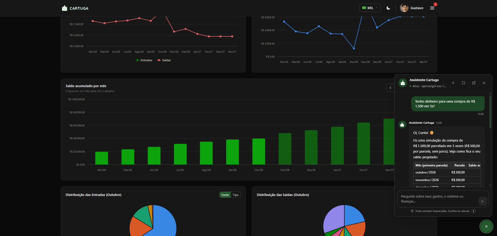
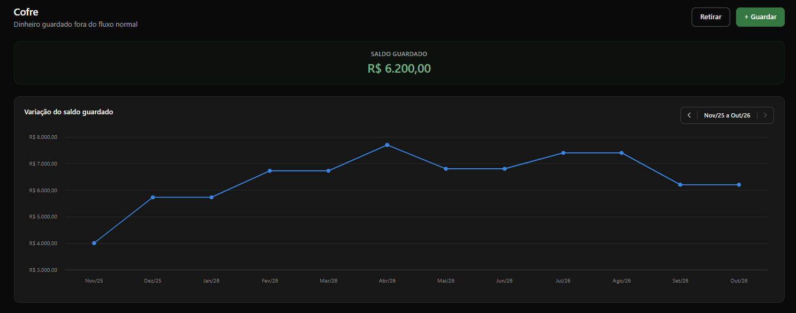
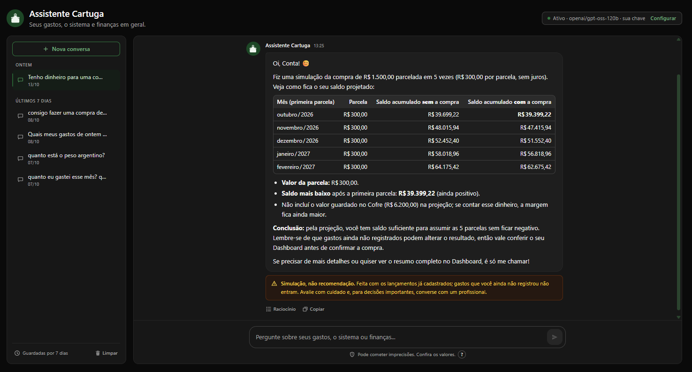

<h1 align="center">
  <picture>
    <source media="(prefers-color-scheme: dark)" srcset="frontend/src/assets/logo/cartuga-logo-dark.svg">
    
  </picture>
</h1>

<p align="center">
  <strong>Controle financeiro pessoal focado no que realmente importa: quanto vai sobrar
  no fim do mês e nos próximos.</strong>
</p>

<p align="center">
  
  
  
  
  
  <br>
  
  
  
  
  
  <br>
  
  
  
</p>

<p align="center">
  
</p>

Cartuga é uma aplicação web full-stack (React + FastAPI + MySQL) para registrar
entradas e saídas, acompanhar compras parceladas no cartão, separar uma reserva
financeira e **projetar o saldo dos próximos meses** com base nos compromissos que já
existem hoje. Projeto pessoal desenvolvido como peça de portfólio.

> [!NOTE]
> **Este é um MVP, uma prova de conceito.** Ele existe para demonstrar as ideias
> centrais (projeção de saldo a partir de um motor financeiro único e um assistente com
> IA cujos números são verificáveis) com qualidade de engenharia, segurança e testes.
> Foi feito para rodar localmente, não está publicado como serviço e ainda não é um
> produto pronto para uso com dados reais. Veja o que está no escopo e o que falta em
> [Status: MVP para prova de conceito](#-status-mvp-para-prova-de-conceito).

---

## 💡 Por que o Cartuga existe

A maioria dos apps de finanças pessoais responde "quanto eu gastei?". O Cartuga foi
pensado para responder outras perguntas, mais úteis no dia a dia:

- **"Se eu fizer essa compra em 10x, como fica meu saldo daqui a 6 meses?"** — as
  parcelas futuras, as contas fixas e as receitas recorrentes já entram na projeção.
- **"Quanto esse registro específico pesa no meu saldo?"** — cada entrada/saída tem um
  botão *Ver impacto* que recalcula toda a série sem ela e mostra a diferença.
- **"E se aquele freela não vier?"** — valores incertos podem ser marcados como
  *Planejados*; o sistema mostra o saldo com e sem eles e cobra uma revisão quando a
  data chega.
- **"Quanto do meu dinheiro é reserva, e não dinheiro para gastar?"** — o *Cofre*
  separa a reserva do fluxo de caixa sem perder a rastreabilidade de onde ela veio.

Todo cálculo de saldo é feito em um único lugar no backend
([`finance_engine.py`](backend/app/services/finance_engine.py)): dashboard, detalhe do
mês, impacto de um registro e comparação de planejados são o **mesmo cálculo** com
parâmetros diferentes, então os números nunca divergem entre telas.

## 🧰 Tecnologias

| Camada | Tecnologias |
|---|---|
| **Frontend** | React 18 e TypeScript, Vite, TanStack Query (cache e estado do servidor), React Router, Tailwind CSS, Highcharts (gráficos), Axios, jsPDF + html-to-image (exportação em PDF) |
| **Backend** | Python 3.12, FastAPI, SQLAlchemy 2.0 (ORM), Alembic (migrations), Pydantic v2 (validação), PyJWT + Argon2id (autenticação), cryptography/Fernet (segredos em repouso), httpx, openpyxl (planilhas) |
| **Banco de dados** | MySQL 8, com valores monetários em `NUMERIC`/`Decimal` de ponta a ponta |
| **Assistente (IA)** | LLM com *tool calling* via API no formato da OpenAI, sem SDK: Groq (`openai/gpt-oss-120b`, plano gratuito), qualquer API compatível ou Ollama local |
| **Integrações** | API PTAX do Banco Central (câmbio oficial do dia) |
| **Infra e qualidade** | Docker Compose, pytest (240 testes em schema isolado), `pip-audit` e `npm audit` |

A arquitetura e os fluxos do Assistente estão em
**[docs/arquitetura.md](docs/arquitetura.md)**.

## 🔑 Conta de demonstração

Ao subir o projeto, uma conta administradora de demonstração é criada
automaticamente. Depois de aplicar as seeds de demonstração (ver
[Dados de demonstração](#-dados-de-demonstração-seeds)), ela passa a ter um histórico
financeiro fictício dos últimos 12 meses até o mês atual.

| Campo | Valor |
|-------|-------|
| E-mail | `demo@cartuga.dev` |
| Senha  | `Cartuga@Demo2026` |

> São credenciais **públicas de propósito**: servem para quem clonar o projeto entrar e
> já encontrar dados. Valem só para a demo na sua máquina (o Compose publica as portas
> apenas em `127.0.0.1`). Em qualquer ambiente exposto, defina outras via
> `INITIAL_ADMIN_*` no `.env`; o backend avisa no log se perceber esse caso.

---

## ✨ Funcionalidades

### 📊 Dashboard
- **Série temporal** de entradas, saídas e saldo mensal, com histórico e projeção
  configuráveis (3/6/12/24 meses ou intervalo personalizado).
- **Saldo acumulado por mês** — meses projetados aparecem com opacidade reduzida;
  clicar em um mês abre o detalhamento completo (o que entrou, o que saiu, quais
  parcelas caíram ali).
- **Navegação mês a mês em cada gráfico**: as setas ‹ › deslizam a janela um mês
  para trás ou para a frente, mantendo a mesma quantidade de meses visíveis, e cada
  gráfico se move de forma independente. O limite para trás é o primeiro mês com
  registros. O limite para a frente é calculado: o último mês em que algum lançamento
  ainda muda o saldo (fim de parcelas, regras fixas com término, planejados futuros)
  ou, se houver uma regra fixa sem data de término, o teto de 60 meses de projeção. Ao
  tentar passar do limite, o gráfico explica por que não dá para ir além. Um botão
  volta ao período padrão.
- **Distribuições** por fonte ou por tipo (fixa/excepcional), em gráficos de pizza.
- **Valor comprometido com parcelas**: soma de todas as parcelas que ainda vão vencer,
  independentemente da janela exibida.
- **Câmbio do dia** (USD/EUR) e histórico das cotações.

### 💸 Entradas e saídas
- Dois tipos de registro:
  - **Fixo** — se repete todo mês entre uma data de início e (opcionalmente) uma de
    término. Ex.: salário, aluguel, plano de saúde, um curso com data para acabar.
  - **Excepcional** — acontece uma única vez. Ex.: bônus, venda de um item, mercado.
- Saídas têm meio de pagamento **Conta** (débito/à vista) ou **Crédito** (parcelado).
- Tabelas com busca, filtros por mês/tipo, ordenação e paginação.
- **Ver impacto**: gráfico do efeito acumulado daquele registro no saldo ao longo do
  tempo.

### 💳 Compras parceladas no crédito
- De 1x a 24x; o valor é dividido em centavos exatos (a última parcela absorve o
  arredondamento, então a soma sempre bate com o total).
- **Ajustes por parcela** — estornos, juros ou cobranças extras em uma fatura
  específica, sem alterar as demais.
- **Antecipação de parcelas** — pagar parcelas futuras no mês atual (em ordem), com
  possibilidade de desfazer.
- Valor, data e parcelamento ficam travados após a criação, para não invalidar
  parcelas e ajustes já registrados.

### 🌎 Multimoeda (BRL, USD, EUR)
- Registros podem ser lançados em dólar ou euro. O backend converte para real usando a
  **PTAX de venda do Banco Central** na data do registro e **congela** essa cotação —
  o valor histórico nunca muda depois.
- Fins de semana e feriados usam o último dia útil anterior; se a API do BACEN cair,
  há um fallback configurável.
- Um seletor global permite **visualizar** todo o app em outra moeda (conversão apenas
  na exibição; o que é armazenado é sempre BRL).

### 🗓️ Planejamentos
- Qualquer entrada, ou saída à vista, pode ser marcada como **Planejada**: um valor
  estimado, ainda não confirmado. Ela conta normalmente nos cálculos, mas entra numa
  **fila de revisão** a partir da véspera da data prevista.
- Na revisão você **Confirma** (podendo ajustar para o valor real) ou **Recusa**
  (o registro deixa de existir nos cálculos).
- Registros **fixos** planejados são revisados **mês a mês** — por exemplo, a conta de
  luz estimada em R$ 180 pode ser confirmada como R$ 193,47 só naquele mês.
- Gráfico de **saldo com vs. sem planejados**, para enxergar o quanto da projeção
  depende de estimativas, e gráficos de entradas e saídas por mês separando o
  confirmado do planejado. Todos com a mesma navegação mês a mês do Dashboard.
- Um indicador no menu mostra quantos itens aguardam revisão.

### 🔒 Cofre (reserva)
Separa o dinheiro guardado do dinheiro disponível, com três movimentações:

| Movimentação | O que representa | Efeito no saldo do dashboard |
|---|---|---|
| **Guardar do zero** | Dinheiro que já existia fora do sistema (ex.: reserva anterior) | Nenhum |
| **Recortar de uma entrada** | Separar parte (% ou valor) de uma receita recebida | Reduz (vira uma saída) |
| **Retirar** | Usar a reserva | Aumenta (vira uma entrada) |

<p align="center">
  
</p>

O Cofre não permite retirar mais do que foi guardado nem recortar mais de 100% de uma
entrada, e cada movimentação fica vinculada ao lançamento real que gerou. O gráfico
do saldo guardado mostra os últimos 12 meses, e as setas ‹ › voltam até a primeira
movimentação. Ele não projeta meses futuros.

### 🏦 Importação de extrato bancário
- Upload do CSV de extrato do **Inter** ou **Nubank**; o sistema classifica cada linha
  como entrada, saída, aplicação ou resgate.
- Tudo passa por uma **tela de revisão** editável antes de gravar — a classificação é
  uma sugestão, nunca é aplicada às cegas.

### 🤖 Assistente Cartuga (chatbot)
Um assistente de finanças, com a tartaruga do logo de óculos, disponível para todos os
perfis. Fica num **pop-up expansível em todas as telas** (botão flutuante no canto) e numa
**página dedicada** com o histórico das conversas (guardado por 7 dias). Responde três tipos de pergunta:

- **sobre o sistema** ("como funciona o parcelamento?", "onde exporto meus dados?"),
  com base num manual embutido;
- **de finanças em geral**, de forma simples ("o que é reserva de emergência?",
  "cotação do dólar hoje");
- **sobre os seus dados**: "quanto gastei dia 12?", "quanto vou ter em dezembro?",
  "posso parcelar R$ 3.000 em 10x com 2% de juros?", "com o que mais gastei nos
  últimos 3 meses?", "quanto tenho no Cofre?".

<p align="center">
  
</p>

**O modelo de linguagem nunca faz as contas.** Ele escolhe entre ferramentas
determinísticas, somente leitura e construídas sobre o mesmo motor financeiro do
dashboard, e só redige a resposta. Uma verificação automática sinaliza qualquer valor
em R$ que não veio dos dados, e simulações de compra sempre trazem um aviso de
cautela. Um aviso permanente na tela lembra que o assistente pode errar e que decisões
financeiras merecem análise humana. Respostas com tabelas são exibidas como tabelas.

**Dados pessoais protegidos antes de sair do servidor:** CPF, CNPJ, número de cartão,
e-mail, telefone e chave Pix são trocados por marcadores (`[CPF]`, `[cartão]`...) em tudo
o que vai ao provedor do modelo, inclusive nas descrições dos lançamentos; a conversa
salva mantém o original. Com o Ollama, nada sai da máquina.

**Isolamento entre usuários garantido no código, não no prompt:** cada ferramenta
recebe o usuário da sessão autenticada, nunca do modelo; argumentos extras (como um
`user_id` "injetado" numa pergunta maliciosa) são descartados e registrados; e testes
executam todas as ferramentas como outro usuário para provar que nada vaza.

**Transparência total do pipeline**, em três lugares:
- **Na conversa**, o botão **Raciocínio** de cada resposta mostra os dados consultados
  e a linha do tempo: cada chamada ao modelo (tempo, tokens, decisão, raciocínio),
  cada consulta (argumentos e os dados exatos devolvidos) e a verificação de cada valor.
- **No terminal do backend**, ao vivo e em texto legível, cada etapa aparece no
  momento em que acontece (`docker compose logs -f backend`), com hora e código de
  rastreio; com `ASSISTANT_TRACE_FORMAT=json`, uma linha JSON por passo.
- **Em Gerenciamento → Logs do Assistente**, o registro completo de cada pergunta e
  teste de conexão, respondido ou não, com filtros, busca e estatísticas. Cada
  administrador vê **apenas os próprios** registros.

Custo zero: usa o plano gratuito do **Groq** (`openai/gpt-oss-120b`), qualquer API
compatível com a da OpenAI, ou um modelo local via **Ollama**, opcional (perfil
`ollama` do Compose; sem GPU fica lento). **Cada usuário pode escolher o modelo e usar a própria chave de API em
Perfil → Assistente Cartuga**: a chave fica criptografada, nunca é exibida de novo e
pode ser testada antes de salvar. O administrador pode definir um padrão no `.env` para
quem não configurar nada. Veja
**[docs/assistente.md](docs/assistente.md)**, o anexo completo com arquitetura, escolha
de modelo, estratégia de exatidão, segurança e como ativar.

### 📤 Exportação (todos os perfis)
- **Dashboard em PDF**: o botão **Exportar** no topo do dashboard abre um modal que
  começa exatamente no que a tela mostra naquele momento: projeção, mês inicial de
  cada gráfico, Fonte/Tipo das pizzas e moeda. O modal descreve em texto o que vai
  no arquivo (mês de referência, projeção, período e meses projetados de cada
  gráfico, agrupamentos, moeda e cotação) e deixa redefinir tudo, inclusive quais
  seções entram, só para o PDF. Ao lado, uma pré-visualização das páginas A4: o PDF
  gerado é exatamente essa pré-visualização. A primeira página traz as mesmas
  configurações por escrito, então o documento se explica sozinho.
- **Dados em CSV**: fica em **Perfil → Exportar meus dados**, de propósito fora do
  dashboard. Você escolhe o período (atalhos ou mês a mês, incluindo **meses
  projetados**), os conjuntos de dados e o formato (Excel pt-BR com `;` e vírgula
  decimal, ou padrão com `,` e ponto). Vê um resumo e as primeiras linhas de cada
  arquivo antes de baixar. Vários conjuntos vêm num `.zip`.

  | Arquivo | Conteúdo |
  |---|---|
  | `resumo_mensal.csv` | Totais, saldo do mês e saldo acumulado por mês, iguais aos gráficos |
  | `lancamentos_por_mes.csv` | Cada lançamento em cada mês em que conta: fixos repetidos, parcelas no mês em que caem, revisões de planejados |
  | `cadastro_de_lancamentos.csv` | Os registros como cadastrados, com moeda e cotação originais |
  | `parcelas.csv` | Parcelas do cartão no período, com ajustes e antecipações |
  | `cofre.csv` | Movimentações do Cofre |

  Cada usuário só exporta os próprios dados. A exportação completa do banco em
  `.xlsx` continua sendo só do administrador.

### 🛠️ Administração
- **Usuários**: criar, editar papel (USER/ADMIN) e excluir contas.
- **Backup completo em `.xlsx`**: exportação de todo o banco e importação com
  validação prévia, `mysqldump` automático antes de qualquer alteração e substituição
  em uma única transação (rollback total se algo falhar). Também é possível
  restaurar o último backup.

### 👤 Conta e interface
- Perfil com foto, troca de nome/e-mail e de senha (que encerra as outras sessões).
- Tema claro/escuro e layout responsivo (desktop, tablet e celular).

---

## 🏆 Destaques técnicos

- **Motor financeiro único** — toda regra de aplicabilidade (meses de um registro
  fixo, mês efetivo de uma parcela antecipada, revisões de planejados) vive em
  `finance_engine.py`. Os recursos de "impacto" e "com/sem planejados" são
  *contrafactuais*: o mesmo cálculo rodado excluindo registros, garantindo coerência
  com o dashboard.
- **Autenticação segura** — access token JWT de curta duração mantido só em memória;
  refresh token opaco, rotacionado a cada uso, armazenado como hash e entregue em
  cookie `httpOnly` + `Secure` + `SameSite=Strict`. Senhas com **Argon2id**.
- **Integridade financeira** — valores em `Decimal`/`NUMERIC` de ponta a ponta;
  snapshot de câmbio congelado por registro; campos sensíveis travados após criação
  (compras no crédito, lançamentos gerados pelo Cofre).
- **Importação atômica** — `DELETE` + `INSERT` (nunca DDL, que faria commit implícito
  no MySQL) dentro de uma transação, com backup prévio e trabalho bloqueante fora do
  event loop.
- **Revisões de segurança documentadas** — XSS em tooltips, segredo JWT público,
  login sem limite de tentativas, entradas sem limite de tamanho e dependências com
  vulnerabilidades conhecidas foram encontrados e corrigidos; ver
  [Segurança](#-segurança) e [`docs/decisions.md`](docs/decisions.md).
- **Assistente com números verificáveis** — chatbot com *tool calling* em que o LLM
  não calcula nada: ferramentas determinísticas sobre o `finance_engine` fornecem os
  valores, uma checagem pós-resposta marca qualquer R$ que não veio dos dados, e o
  raciocínio de cada resposta fica visível. Provedor plugável (Groq gratuito, API
  compatível com OpenAI ou Ollama local) sem SDK, isolamento entre usuários testado,
  rastreio completo do pipeline, histórico com retenção de 7 dias e limite por
  usuário. Detalhes em [`docs/assistente.md`](docs/assistente.md).
- **Testes** — 240 testes pytest cobrindo autenticação, segurança, motor financeiro,
  parcelas, câmbio, planejados, Cofre, importação/exportação, importação bancária e o
  Assistente (isolamento, logs, provedores), rodando em um schema de banco isolado.

## 🏗️ Arquitetura

```
┌───────────────────────┐   HTTPS/JSON   ┌──────────────────────────┐        ┌─────────┐
│  Frontend (SPA)       │ ─────────────▶ │  Backend (FastAPI)       │ ─────▶ │ MySQL 8 │
│  React + TS + Vite    │ ◀───────────── │  routers → services →    │        └─────────┘
│  TanStack Query       │  JWT + cookie  │  repositories → models   │
│  Highcharts/Tailwind  │                │  finance_engine (núcleo) │ ─────▶ API PTAX (BACEN)
└───────────────────────┘                └──────────────────────────┘
```

Camadas, modelo de dados, motor financeiro, autenticação e os fluxos do Assistente
(com diagramas) estão em [`docs/arquitetura.md`](docs/arquitetura.md).

---

## 🚀 Rodando localmente

Pré-requisito: Docker com Docker Compose.

**1. Crie o `.env` e defina um `JWT_SECRET` próprio** (o único passo obrigatório):

```bash
cp .env.example .env
openssl rand -base64 48     # cole o resultado em JWT_SECRET= no .env
```

No PowerShell, gere o segredo com:

```powershell
$b=New-Object byte[] 48; [Security.Cryptography.RandomNumberGenerator]::Create().GetBytes($b); [Convert]::ToBase64String($b)
```

O backend **se recusa a subir** com o valor de exemplo (que é público e permitiria
forjar sessões) ou com menos de 32 caracteres. Se você esquecer, a mensagem de erro
em `docker compose logs backend` já sugere um valor pronto.

**2. Suba e carregue os dados de demonstração:**

```bash
docker compose up --build -d
docker compose exec backend python -m app.seeds
```

**3. Entre** em http://localhost:5173 com a [conta demo](#-conta-de-demonstração).

| Serviço | Endereço |
|---|---|
| Aplicação | http://localhost:5173 |
| API + Swagger | http://localhost:8001/docs |
| MySQL | localhost:3307 |

Na primeira subida o backend aplica as migrations (Alembic) e cria o usuário ADMIN
definido em `INITIAL_ADMIN_*` (operação idempotente). Todas as portas são publicadas
só em `127.0.0.1`: as credenciais de demonstração são públicas, então nada fica
acessível pela rede local.

**Assistente (opcional):** para conversar com ele, coloque uma chave gratuita do Groq
(https://console.groq.com/keys) em `ASSISTANT_API_KEY` no `.env`, ou cadastre a sua
em Perfil → Assistente Cartuga depois de entrar. Sem chave, todo o resto funciona e o
assistente apenas avisa que não está configurado.

> As portas do host do backend (8001) e do MySQL (3307) foram deslocadas para não
> conflitar com serviços locais; dentro da rede Docker continuam `backend:8000` e
> `mysql:3306`.

## 🌱 Dados de demonstração (seeds)

O projeto tem dois tipos de seed:

| Seed | Quando roda | O que faz |
|---|---|---|
| **Admin** ([`app/seed.py`](backend/app/seed.py)) | Automaticamente, a cada boot do backend | Cria a conta ADMIN de `INITIAL_ADMIN_*` se ela ainda não existir. |
| **Demonstração** ([`app/seeds/`](backend/app/seeds/)) | Manualmente, quando você quiser | Carrega os registros fictícios (mocks) na conta ADMIN. |

### Os mocks

Os dados fictícios ficam em arquivos JSON em
[`backend/app/seeds/mocks/`](backend/app/seeds/mocks/), separados da lógica que os
carrega.

**As datas são relativas ao dia em que a seed roda.** O histórico sempre vai de 12
meses atrás até o mês atual: rodando em outubro/2026, ele começa em outubro/2025;
rodando em março/2027, começa em março/2026. Alguns registros planejados ficam nos
meses seguintes, para aparecerem na projeção. Nos JSONs, uma data é escrita assim:

| Formato | Significado |
|---|---|
| `{"month": -12, "day": 5}` | Dia 5 do mês que fica 12 meses antes do atual |
| `{"month": 0, "day": "last"}` | Último dia do mês atual |
| `{"month": 2, "day": 18}` | Dia 18 daqui a dois meses |
| `{"days": -2}` | Dois dias antes de hoje |

Um registro que já aconteceu (qualquer um que não seja *Planejado*) nunca fica
depois de hoje. Se a data dele cair mais à frente no mês atual, ele é movido para o
dia de hoje.

| Arquivo | Conteúdo |
|---|---|
| `entries.json` | Entradas **fixas**: salário (com promoção no meio do período), aluguel de vaga de garagem (já encerrado), freela recorrente em **dólar** e royalties em **euro**. Entradas **excepcionais**: bônus, PLR, reembolso, cashback, restituição do IR, vendas, freelas e uma consultoria em euro. |
| `fixed_expenses.json` | Saídas **fixas**: aluguel (com reajuste), condomínio, internet, celular, plano de saúde, streaming, seguro do carro (troca de apólice), assinatura em **dólar**, academia, doação e um curso com data de término. |
| `variable_expenses.json` | **Padrões** de gasto do dia a dia (mercado, padaria, delivery, combustível, farmácia, pet shop...). Cada padrão vira N gastos por mês, com dia, valor e descrição sorteados dentro da faixa. O sorteio usa semente fixa, então o resultado é reproduzível. |
| `one_off_expenses.json` | Saídas **excepcionais** pontuais, incluindo uma em dólar e outra em euro. |
| `credit_purchases.json` | Compras no **crédito** de 1x a 10x, em real, dólar e euro, com um **estorno** (ajuste negativo) e uma cobrança de **juros** (ajuste positivo) em parcelas específicas, além de **2 parcelas antecipadas**. |
| `planned.json` | Registros **Planejados**. Excepcionais: um atrasado, um que entra na fila amanhã e outros futuros. Fixos revisados mês a mês: conta de luz **confirmada com o valor real**, conta de água **confirmada como estimada**, aulas particulares **recusadas** neste mês e **confirmadas** no próximo, e uma mensalidade que só começa no mês que vem. |
| `vault.json` | **Cofre**: dois depósitos "do zero", recortes de entradas **por percentual** e **por valor fixo**, e duas retiradas. |

Os demais campos seguem o mesmo formato da API (`POST /entries`, `POST /expenses`,
`POST /vault/transactions`), então para mudar a demo basta editar os JSONs. Os
recortes do Cofre apontam para a entrada de origem pela chave `ref`/`source_ref`, não
por ID. As revisões mês a mês (`reviews`) só aceitam o mês atual em diante (`month
>= 0`), porque o sistema só permite revisar a partir do mês em que o registro foi
marcado como Planejado.

As seeds cadastram tudo **pela API HTTP**, não direto no banco. Por isso todas as
regras de negócio valem como se os dados tivessem sido digitados na interface:
conversão pela PTAX do dia, geração de parcelas, limites do Cofre e fila de revisão
dos planejados.

### Aplicar, desfazer e recriar

Com os containers no ar:

```bash
# aplicar os mocks na conta demo
docker compose exec backend python -m app.seeds

# desfazer: remove todos os registros financeiros da conta demo
docker compose exec backend python -m app.seeds --undo

# recriar: desfaz e aplica de novo (útil depois de editar os mocks)
docker compose exec backend python -m app.seeds --reset
```

- **Aplicar** se recusa a rodar se a conta já tiver lançamentos, para não duplicar
  dados. Nesse caso use `--reset`.
- **Desfazer** apaga **todos** os lançamentos da conta demo (entradas, saídas,
  parcelas, ajustes, Cofre e revisões de planejados), inclusive os criados à mão pela
  interface. A conta em si e os outros usuários não são tocados.
- Para zerar **o banco inteiro**, inclusive usuários e backups:

  ```bash
  docker compose down -v
  docker compose up --build -d
  docker compose exec backend python -m app.seeds
  ```

> Como as datas são calculadas no momento em que a seed roda, os dados não avançam
> sozinhos com o tempo. Para deixar a demo atualizada (os últimos 12 meses até o mês
> atual), rode `--reset` de novo.

## 🧪 Testes

```bash
docker compose exec backend pytest                # backend (schema isolado cartuga_test)
docker compose exec frontend npm run typecheck    # checagem de tipos do frontend
docker compose exec frontend npm run build        # build de produção do frontend
```

O schema `cartuga_test` é criado automaticamente por
[`docker/mysql/init/01-test-database.sh`](docker/mysql/init/01-test-database.sh). O
frontend não tem suíte automatizada; a interface foi validada manualmente com
Playwright em viewports desktop, tablet e mobile.

## ⚙️ Variáveis de ambiente

Todas estão documentadas em [`.env.example`](.env.example):

| Variável | Para que serve |
|---|---|
| `JWT_SECRET` | **Obrigatória e privada.** Assina os tokens; o backend não sobe sem ela, com menos de 32 caracteres ou com o valor de exemplo. |
| `MYSQL_ROOT_PASSWORD`, `MYSQL_DATABASE`, `MYSQL_USER`, `MYSQL_PASSWORD` | Credenciais do banco (aplicadas na criação do volume); o backend também as usa para montar a conexão e fazer backups. |
| `TEST_DATABASE_URL` | Banco usado pela suíte pytest. |
| `ACCESS_TOKEN_EXPIRE_MINUTES`, `REFRESH_TOKEN_EXPIRE_DAYS` | Duração da sessão. |
| `CORS_ORIGINS` | Origens autorizadas a chamar a API. |
| `COOKIE_SECURE` | Flag `Secure` do cookie de refresh token. |
| `INITIAL_ADMIN_NAME/EMAIL/PASSWORD` | Conta ADMIN criada no primeiro boot (e usada pelas seeds). |
| `EXCHANGE_RATE_USD/EUR` | Cotação de fallback se a API do Banco Central estiver fora. |
| `DB_BACKUP_DIR` | Onde ficam os dumps feitos antes de cada importação. |
| `ASSISTANT_PROVIDER`, `ASSISTANT_API_KEY` | Provedor padrão do Assistente (`groq`, `ollama`, `openai_compatible`, `disabled`) e a chave gratuita do Groq. Sem chave, o assistente avisa que não está configurado. |
| `ASSISTANT_MAX_MESSAGES_PER_HOUR`, `ASSISTANT_HISTORY_DAYS` | Limite de perguntas por usuário/hora e retenção do histórico (7 dias). |
| `ASSISTANT_TRACE_LOG`, `ASSISTANT_TRACE_FORMAT` | Rastreio do pipeline no terminal: `summary` (sem conteúdo do usuário), `full` ou `off`; em texto legível (`text`) ou `json`. |
| `ASSISTANT_LOG_DAYS` | Retenção dos registros completos em Gerenciamento → Logs do Assistente (`0` desliga). |
| `ASSISTANT_OLLAMA_URL` | Endereço do Ollama, quando usado. |
| `VITE_API_BASE_URL` | URL da API vista pelo navegador. É a única variável repassada ao container do frontend. |

Há também variáveis **opcionais**, comentadas no fim do `.env.example`, que já têm
padrão no código (`DATABASE_URL` fora do Docker, `JWT_ALGORITHM`, `MYSQL_HOST/PORT`,
caminhos do `mysqldump`/`mysql`, modelo e tempo limite do Assistente,
`ASSISTANT_ENCRYPTION_KEY`).

## 📁 Estrutura do projeto

```
cartuga/
├── backend/
│   ├── app/
│   │   ├── routers/        # endpoints HTTP (finos: validação e delegação)
│   │   ├── services/       # regras de negócio; finance_engine.py é o núcleo
│   │   │                   # data_export_service.py gera os CSVs
│   │   ├── repositories/   # acesso a dados
│   │   ├── models/         # modelos SQLAlchemy
│   │   ├── schemas/        # contratos Pydantic de entrada/saída
│   │   ├── auth/           # JWT, cookies, dependências de autorização
│   │   ├── assistant/      # Assistente Cartuga: LLM, ferramentas, manual, verificação
│   │   ├── seed.py         # cria o ADMIN inicial (automático)
│   │   └── seeds/          # seeds de demonstração (aplicar/desfazer)
│   │       └── mocks/      # dados fictícios em JSON
│   ├── alembic/            # migrations
│   └── tests/              # suíte pytest
├── frontend/src/
│   ├── pages/              # Dashboard, Entradas, Saídas, Cofre, Planejamentos, Perfil, Admin
│   ├── components/         # componentes de UI e gráficos
│   ├── contexts/           # auth, moeda, tema, toasts
│   └── services/           # cliente HTTP
├── docker/mysql/init/      # cria o schema de testes
├── docs/arquitetura.md     # arquitetura do sistema e fluxos do Assistente
├── docs/decisions.md       # decisões de arquitetura e regras de negócio
├── docs/assistente.md      # anexo: o Assistente Cartuga em detalhe
└── docker-compose.yml
```

## 🛡️ Segurança

Resumo do que protege a aplicação (detalhes e histórico em
[`docs/decisions.md`](docs/decisions.md#revisão-de-segurança-fase-7)):

| Área | Proteção |
|---|---|
| Sessão | Access token JWT de 15 min só em memória; refresh token opaco, rotacionado, guardado como hash, em cookie `httpOnly` + `Secure` + `SameSite=Strict`. |
| Segredos | `JWT_SECRET` obrigatório, com 32+ caracteres e diferente de qualquer valor público de exemplo; chaves de API dos usuários criptografadas em repouso (Fernet) e nunca devolvidas pela API. Nenhum segredo no repositório: o `.env` é ignorado pelo git. |
| Login | Senhas com Argon2id; até 5 falhas por conta e 20 por endereço a cada 15 min (depois, 429); e-mail inexistente leva o mesmo tempo que senha errada, para não revelar quem tem conta. |
| Autorização | Todo endpoint, exceto login/refresh, exige sessão; toda consulta filtra pelo dono (acessar o registro de outra pessoa dá 404); administração exige papel ADMIN. |
| Entrada | Limites de tamanho iguais aos do banco (422, nunca erro 500); foto de perfil só como URL `http(s)`; nenhuma SQL montada com texto do usuário; nenhum HTML vindo do usuário ou do modelo é injetado na página. |
| Assistente | Isolamento entre usuários no código; somente leitura; URLs personalizadas só HTTPS e públicas (contra SSRF); logs completos visíveis só ao próprio administrador. |
| Dados pessoais e o LLM | Só o necessário vai ao provedor do modelo (primeiro nome, sem e-mail nem IDs), e CPF, CNPJ, cartão, e-mail, telefone e chave Pix são **mascarados antes de qualquer envio**, na pergunta, no histórico e nos dados consultados. A interface avisa o que sai; com o Ollama, nada sai da máquina. Ver [`docs/assistente.md`](docs/assistente.md#dados-pessoais-e-o-modelo-de-linguagem). |
| Rede local | Compose publica MySQL, API e frontend apenas em `127.0.0.1`; a API envia `X-Content-Type-Options`, `X-Frame-Options` e `Referrer-Policy`. |
| Dependências | Versões fixadas (`requirements.txt`, `package-lock.json` com `npm ci`); auditadas com `pip-audit` e `npm audit`, sem vulnerabilidades conhecidas nas dependências de execução. |

Pendências conhecidas: o build do frontend usa Tailwind CSS 3, cujas dependências de
build têm alertas no `npm audit` (só no ambiente de desenvolvimento, nada vai para o
navegador; a correção exige migrar para o Tailwind 4); e o limite de tentativas de
login fica na memória de um único processo.

## 🌐 Rodando em produção

O projeto é publicado como código, para rodar localmente; o `docker-compose.yml` é
voltado a desenvolvimento (bind mounts, `uvicorn --reload`, Vite em modo dev, processos
como root). Para publicar de verdade, no mínimo:

- **Segredos**: `JWT_SECRET` único, senhas novas do MySQL e credenciais
  `INITIAL_ADMIN_*` privadas (nunca as da demo).
- **Backend**: imagem sem bind mount, sem `--reload` e com usuário não-root;
  `alembic upgrade head` como passo de deploy separado; considerar desligar `/docs`.
- **Frontend**: `npm run build` servido por um servidor HTTP/CDN, com cabeçalhos de
  segurança (CSP, HSTS).
- **HTTPS** real (exigido por `COOKIE_SECURE=true`) e `CORS_ORIGINS` restrito ao
  domínio do frontend.
- **Limite de login compartilhado** (ex.: Redis) se houver mais de um processo.
- **Backups**: `DB_BACKUP_DIR` em um volume persistente e monitorado.

## 🚧 Status: MVP para prova de conceito

O Cartuga é um **MVP (produto mínimo viável) construído como prova de conceito**. O
objetivo é validar, de ponta a ponta, que duas ideias funcionam juntas, e não entregar
um produto pronto para produção.

**O que esta prova de conceito demonstra:**

- **Projeção de saldo confiável**: um único motor financeiro calcula todos os números
  do sistema (dashboard, impacto de um registro, planejados, exportações), então as
  telas nunca divergem.
- **IA com números verificáveis**: o assistente conversa em linguagem natural, mas
  todo valor vem de consultas determinísticas ao mesmo motor; uma verificação
  automática sinaliza o que não veio dos dados, e o raciocínio de cada resposta fica
  visível.
- **Fundamentos de engenharia**: autenticação segura, isolamento entre usuários,
  proteção de dados pessoais antes de enviá-los ao modelo, rastreabilidade completa,
  240 testes automatizados e dependências auditadas.

**O que fica fora do escopo do MVP** (limites conhecidos e assumidos):

| Área | Situação atual |
|---|---|
| Implantação | Roda localmente com Docker Compose em modo de desenvolvimento (`--reload`, servidor de dev do Vite, portas só em `127.0.0.1`); não há deploy, HTTPS nem infraestrutura de produção. |
| Contas | Usuários são criados pelo administrador; não há cadastro público, recuperação de senha por e-mail nem autenticação em dois fatores. |
| Escala | Um único processo de backend; o limite de tentativas de login fica em memória. |
| Dados bancários | Importação de extrato só por CSV do Inter e do Nubank; sem integração automática com bancos (Open Finance). |
| Moedas | BRL, USD e EUR. |
| Assistente | Depende de um provedor de LLM: o plano gratuito do Groq tem limites de uso, e o Ollama local é lento sem GPU. O mascaramento de dados pessoais reconhece identificadores com formato fixo (CPF, cartão, e-mail...), não nomes de pessoas. A qualidade das respostas varia com o modelo. |
| Testes | Backend coberto por pytest; o frontend foi validado manualmente, sem suíte automatizada. |
| Interface | Português do Brasil apenas; alguns alertas do `npm audit` no ferramental de build (Tailwind 3), sem impacto no navegador. |

**Para ir além do MVP**, os próximos passos naturais seriam: configuração de produção
(imagens sem `--reload`, usuário não-root, HTTPS, CSP), cadastro e recuperação de
senha, limite de login compartilhado (ex.: Redis), testes automatizados do frontend,
integração bancária e um provedor de LLM escolhido para dados reais, com política de
privacidade adequada (ou o Ollama, em que nada sai do servidor). O que seria preciso
para publicar está detalhado em [Rodando em produção](#-rodando-em-produção).

## 📚 Documentação

| Documento | Conteúdo |
|---|---|
| [`docs/arquitetura.md`](docs/arquitetura.md) | Arquitetura do sistema e fluxos do Assistente, com diagramas |
| [`docs/assistente.md`](docs/assistente.md) | O Assistente em detalhe: modelos, ferramentas, exatidão, segurança, configuração |
| [`docs/decisions.md`](docs/decisions.md) | Decisões de arquitetura, regras de negócio e as revisões de segurança |
