# Arquitetura do Cartuga

Como o sistema é organizado e como as peças conversam, com foco especial nos fluxos do
Assistente Cartuga. Para as regras de negócio e o porquê de cada decisão, veja
[`decisions.md`](decisions.md); para o Assistente em profundidade (modelos, custos,
estratégia de exatidão), veja [`assistente.md`](assistente.md).

Os diagramas usam Mermaid e são renderizados pelo próprio GitHub.

> **Contexto:** o Cartuga é um MVP construído como prova de conceito, para rodar
> localmente. O que está no escopo e os limites conhecidos estão no
> [README](../README.md#-status-mvp-para-prova-de-conceito).

**Sumário**

1. [Visão geral](#1-visão-geral)
2. [Containers e rede](#2-containers-e-rede)
3. [Backend em camadas](#3-backend-em-camadas)
4. [Frontend](#4-frontend)
5. [Modelo de dados](#5-modelo-de-dados)
6. [Motor financeiro](#6-motor-financeiro)
7. [Autenticação e sessão](#7-autenticação-e-sessão)
8. [Assistente: componentes](#8-assistente-componentes)
9. [Assistente: fluxo de uma pergunta](#9-assistente-fluxo-de-uma-pergunta)
10. [Assistente: escolha do provedor](#10-assistente-escolha-do-provedor)
11. [Assistente: laço de ferramentas e isolamento](#11-assistente-laço-de-ferramentas-e-isolamento)
12. [Assistente: falhas e tentativas](#12-assistente-falhas-e-tentativas)
13. [Assistente: rastreabilidade](#13-assistente-rastreabilidade)
14. [Segurança em camadas](#14-segurança-em-camadas)

---

## 1. Visão geral

Uma SPA em React conversa com uma API REST em FastAPI, que guarda tudo em MySQL. A API
consulta a PTAX do Banco Central para câmbio e, quando o Assistente é usado, um modelo
de linguagem por uma API no formato da OpenAI.

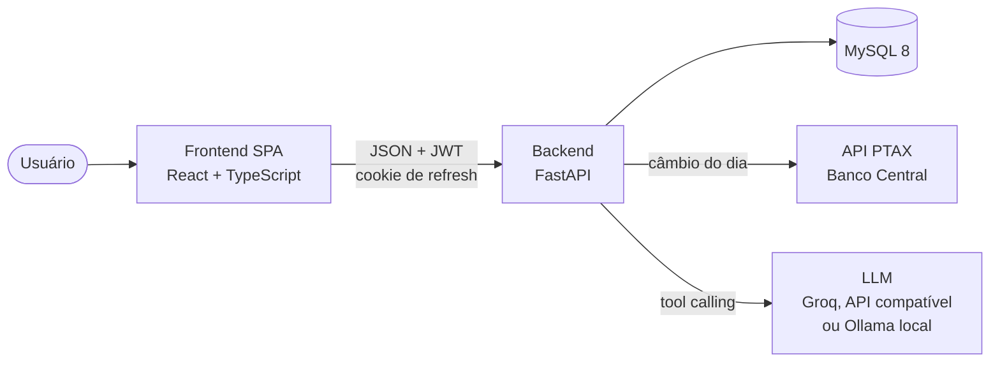

Princípios que atravessam o sistema:

- **Um único lugar calcula saldo.** Todo número de saldo, de qualquer tela, sai do
  `finance_engine.py` (seção 6). O Assistente usa o mesmo motor.
- **Dinheiro é `Decimal`**, do banco (`NUMERIC`) à resposta JSON (string), nunca
  `float`.
- **Toda consulta pertence a um dono.** O `user_id` vem sempre da sessão autenticada,
  e cada consulta ao banco filtra por ele.

## 2. Containers e rede

O `docker-compose.yml` sobe três serviços, mais um opcional. Todas as portas são
publicadas só em `127.0.0.1`.

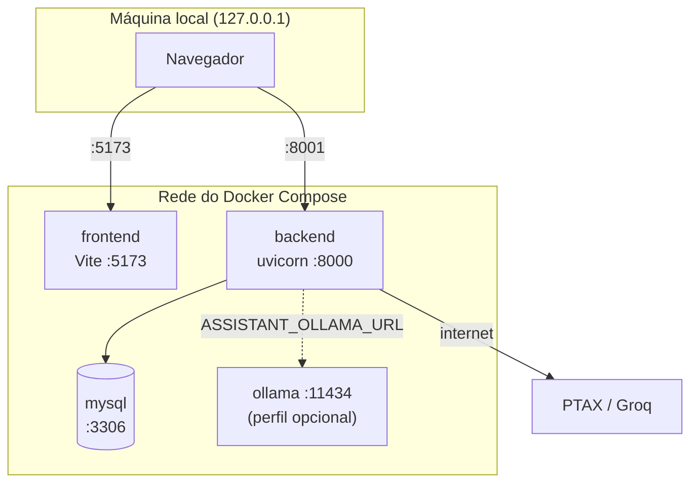

| Serviço | Papel | Observações |
|---|---|---|
| `mysql` | Banco | Volume `mysql_data`; o script de `docker/mysql/init/` cria o schema `cartuga_test` para a suíte de testes |
| `backend` | API | Na subida: `alembic upgrade head`, cria o ADMIN inicial e inicia o uvicorn; recebe o `.env` inteiro |
| `frontend` | SPA | Servidor de desenvolvimento do Vite; recebe só `VITE_API_BASE_URL` |
| `ollama` | LLM local | Só com `docker compose --profile ollama up -d` |

## 3. Backend em camadas

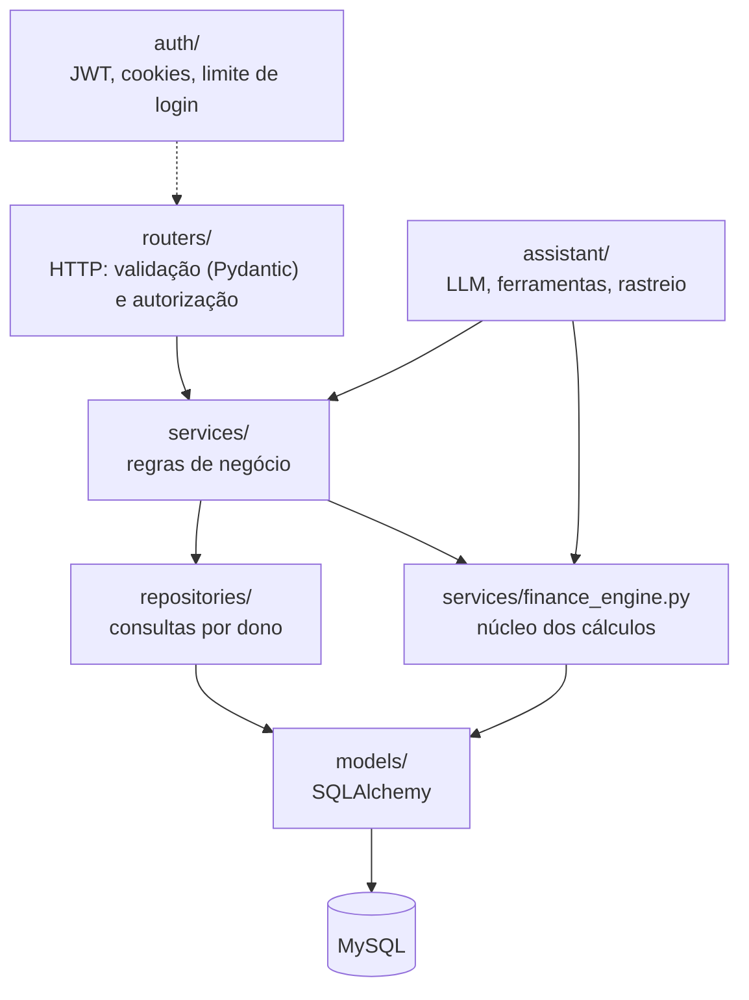

| Pasta | Responsabilidade |
|---|---|
| `routers/` | Endpoints finos: recebem o schema validado, exigem `get_current_user` ou `require_admin` e delegam |
| `schemas/` | Contratos de entrada e saída; `common.py` aplica os limites das colunas (texto longo vira 422, nunca 500) |
| `services/` | Regras de negócio (parcelas, Cofre, Planejados, importações, exportações) |
| `services/finance_engine.py` | Aplicabilidade mês a mês e séries de saldo; usado por dashboard, impacto, planejados, exportação e Assistente |
| `repositories/` | Consultas reutilizáveis, sempre com `user_id` |
| `models/` | Tabelas SQLAlchemy 2.0; migrations em `alembic/versions/` |
| `auth/` | Argon2id, JWT, cookie de refresh, limite de tentativas de login |
| `assistant/` | O Assistente (seções 8 a 13) |

Erros de negócio são exceções `AppError` convertidas num envelope único:
`{"error": {"code", "message"}}`, com a mensagem em português pronta para a tela.

## 4. Frontend

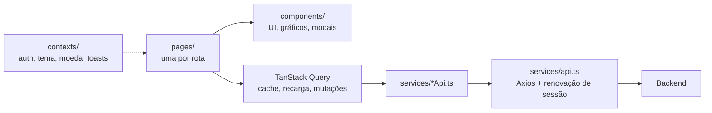

- **Estado do servidor** fica no TanStack Query (nada de store global para dados da
  API). Mutações invalidam as chaves afetadas.
- **Sessão**: o token de acesso vive só em memória; ao receber 401, o interceptor do
  Axios chama `/auth/refresh` uma vez e repete a requisição (seção 7).
- **Moeda de exibição** (BRL, USD, EUR) é só apresentação: os valores chegam em BRL e
  são convertidos na tela.
- **Respostas do Assistente** em Markdown viram elementos React por um renderizador
  próprio (`MarkdownText.tsx`); nenhum HTML vindo do modelo é injetado.

## 5. Modelo de dados

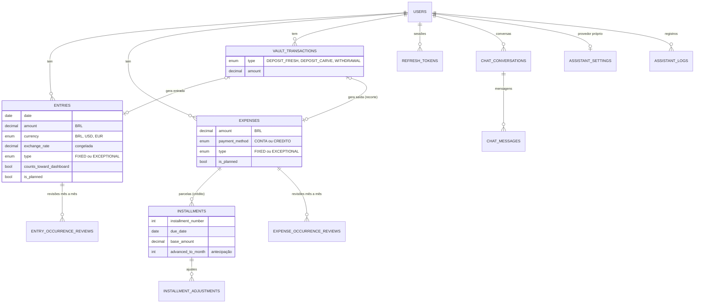

- Registros **fixos** são uma regra (início e término opcionais), não linhas por mês:
  o motor os expande ao calcular.
- Valores em moeda estrangeira guardam o valor original, a cotação PTAX da data e o
  equivalente em BRL; a cotação nunca muda depois.
- Toda tabela de usuário tem `ON DELETE CASCADE` a partir de `users`.
- As tabelas do Assistente (`chat_*`, `assistant_settings`, `assistant_logs`) têm
  retenção própria (seções 9 e 13).

## 6. Motor financeiro

`finance_engine.py` responde uma pergunta: **o que vale em cada mês?**

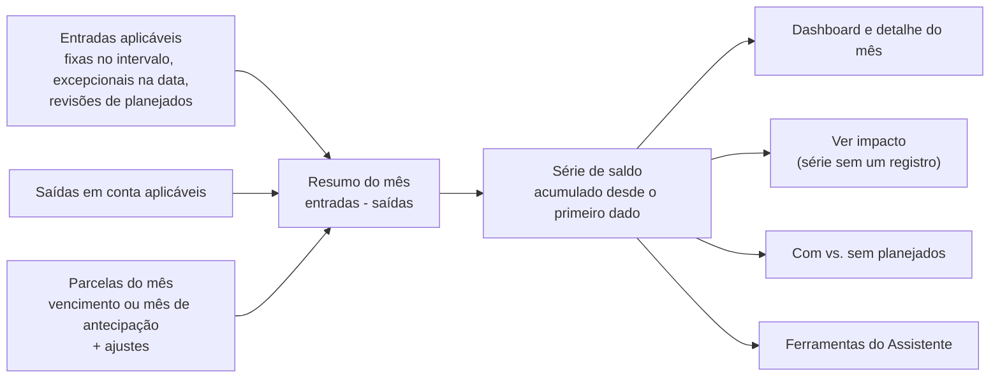

- **Contrafactuais**: "impacto de um registro" e "saldo sem planejados" são a mesma
  série recalculada com exclusões, por isso nunca divergem do dashboard.
- **Projeção**: meses futuros repetem fixos, parcelas e planejados já cadastrados, até
  60 meses à frente.
- **Cofre**: guardar "do zero" cria uma entrada que não conta no saldo; recortar de uma
  entrada cria uma saída; retirar cria uma entrada que conta.

## 7. Autenticação e sessão

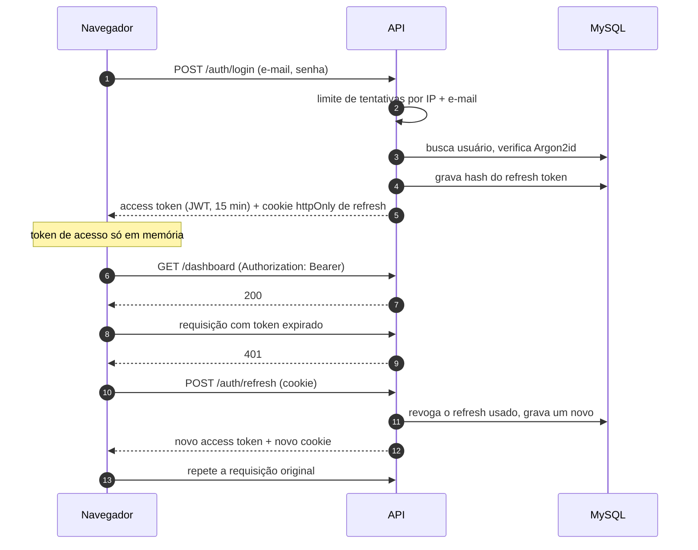

- O refresh token é aleatório e opaco, guardado só como SHA-256; cada uso o revoga
  (rotação). Trocar a senha revoga todos.
- O cookie é `httpOnly`, `Secure`, `SameSite=Strict` e restrito ao caminho `/auth`.
- `JWT_SECRET` precisa ser privado e ter 32+ caracteres; o backend recusa o valor de
  exemplo.

---

## 8. Assistente: componentes

O Assistente responde sobre o sistema, sobre finanças em geral e sobre os dados do
próprio usuário. A regra central: **o modelo escolhe ferramentas e redige; quem calcula
é o código.**

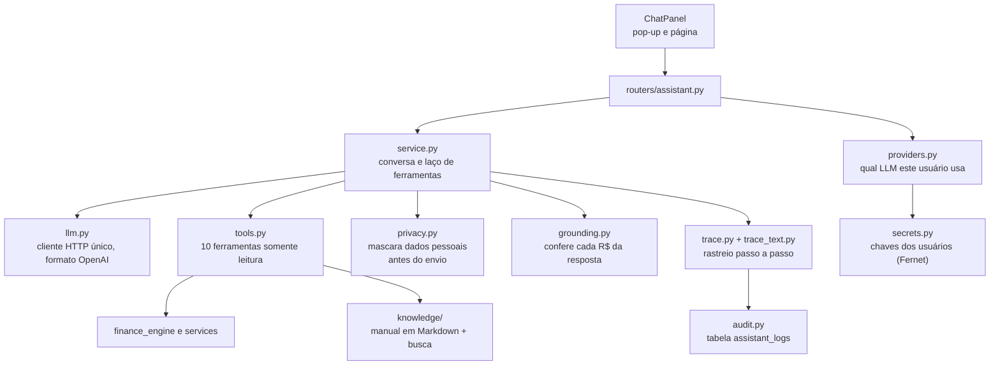

| Ferramenta | Para que serve |
|---|---|
| `get_current_snapshot` | Cards do dashboard: saldo agora, mês atual, projeção, parcelas, Cofre |
| `get_month_overview` | Totais e principais fontes de um mês |
| `get_period_summary` | Mês a mês de um período (até 36 meses) |
| `list_records` | Lançamentos entre duas datas, com busca e ordenação |
| `rank_by_source` | Com o que mais gastou, ou maiores fontes de renda |
| `simulate_purchase` | Compra à vista ou parcelada, com juros, sobre a projeção |
| `get_vault_summary` | Saldo e movimentações do Cofre |
| `get_exchange_rates` | Dólar e euro do dia (PTAX) |
| `get_pending_reviews` | Planejados aguardando confirmação |
| `search_help` | Busca no manual do Cartuga |

## 9. Assistente: fluxo de uma pergunta

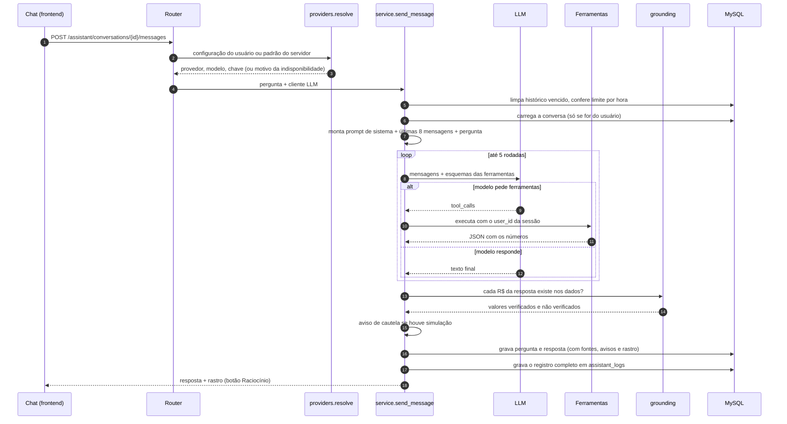

Pontos importantes:

- **Contexto enxuto**: só o texto visível das últimas 8 mensagens vai ao modelo. Os
  resultados de ferramentas de turnos anteriores não são reenviados; se precisar de
  números de novo, o modelo chama a ferramenta outra vez. Isso cabe no limite de tokens
  por minuto do plano gratuito.
- **Se o provedor falhar**, nada é gravado na conversa (a pergunta pode ser reenviada),
  mas o registro em `assistant_logs` e o terminal guardam a falha.
- **Retenção**: conversas por 7 dias (`ASSISTANT_HISTORY_DAYS`), apagadas de forma
  preguiçosa a cada requisição; registros completos por 30 dias (`ASSISTANT_LOG_DAYS`).

## 10. Assistente: escolha do provedor

Cada usuário pode usar a própria chave (Perfil → Assistente Cartuga); quem não
configura nada usa o padrão do servidor.

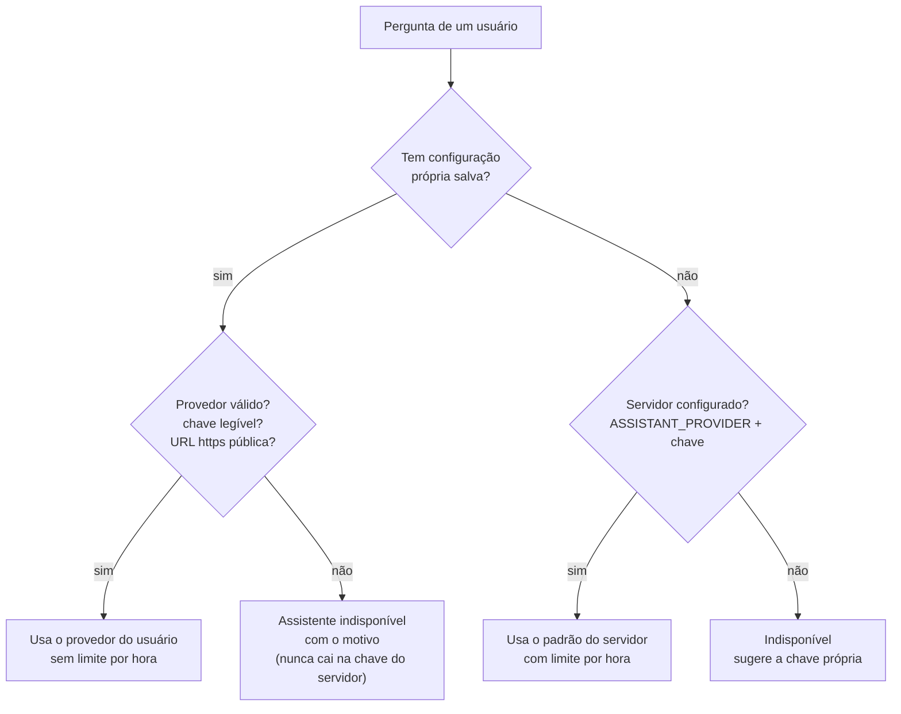

| Provedor | Endereço | Chave |
|---|---|---|
| `groq` | Fixo (`api.groq.com`) | Obrigatória |
| `ollama` | `ASSISTANT_OLLAMA_URL`, definido pelo administrador | Não |
| `openai_compatible` | Informado pelo usuário: só `https` e só IPs públicos, checado ao salvar e a cada uso (contra SSRF) | Opcional |

O teste de conexão do Perfil usa a mesma resolução, com os valores ainda não salvos, e
também é rastreado e registrado.

## 11. Assistente: laço de ferramentas e isolamento

O isolamento entre usuários é garantido pelo código, não por instruções ao modelo.

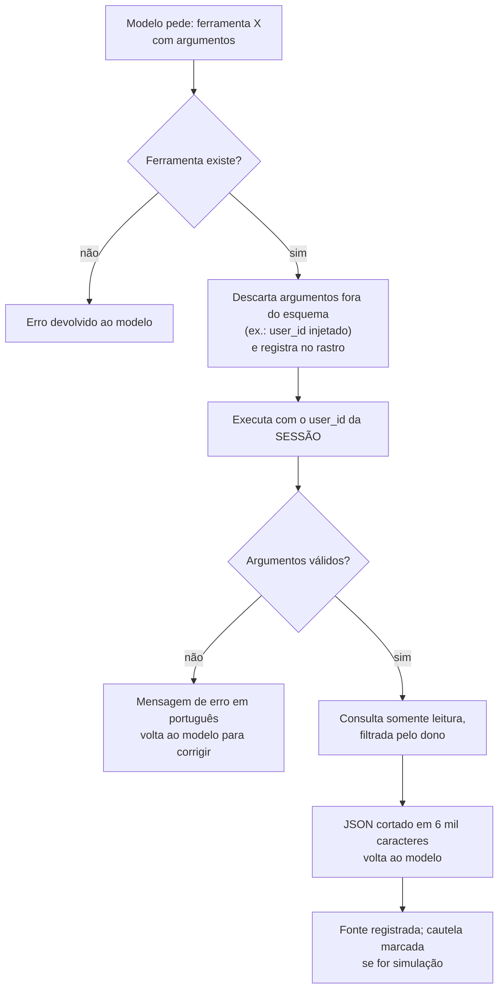

Camadas de proteção:

1. Nenhuma ferramenta recebe `user_id` do modelo; o parâmetro nem existe nos esquemas.
2. Argumentos não declarados são removidos antes da execução.
3. Toda consulta ao banco filtra pelo dono; a conversa de outra pessoa responde 404
   antes de o modelo ser chamado.
4. O prompt manda recusar pedidos de dados de terceiros.
5. Testes executam **todas** as ferramentas como outro usuário e falham se algo vazar
   (`test_assistant_isolation.py`).

Depois do laço, `grounding.py` compara cada "R$" da resposta com os números das
ferramentas e da pergunta; o que não bate aparece na tela como "não verificado".

### Dados pessoais na fronteira com o provedor

Tudo o que o modelo lê sai do servidor quando o provedor é externo. Por isso existe uma
fronteira explícita: nada atravessa sem passar por `privacy.py`.

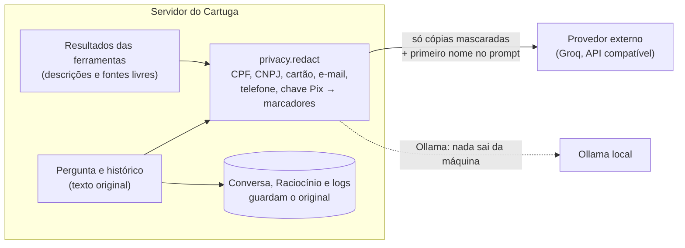

Nunca saem: e-mail, sobrenome, senha, IDs do banco, chaves de API e dados de outros
usuários. Os detalhes, os padrões reconhecidos e os riscos que continuam estão em
[`assistente.md`](assistente.md#dados-pessoais-e-o-modelo-de-linguagem).

## 12. Assistente: falhas e tentativas

`llm.py` tenta o modelo principal e, se houver, o modelo reserva. Cada tentativa é
registrada com o resultado, o tempo e o detalhe técnico.

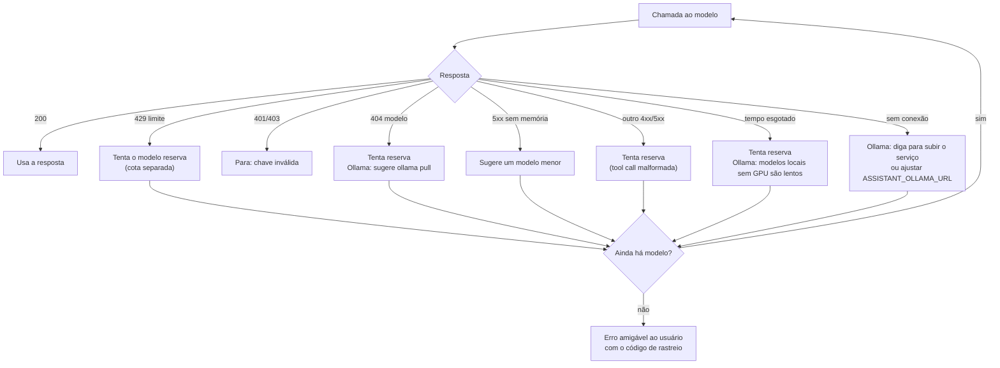

No Ollama, o raciocínio (*thinking*) dos modelos é desligado: na CPU ele levava
minutos e podia consumir todo o limite de saída sem chegar à resposta.

## 13. Assistente: rastreabilidade

Cada pergunta e cada teste de conexão geram um **rastro**: uma lista de etapas
cronometradas, identificada por um código de 12 caracteres que também aparece nas
mensagens de erro.

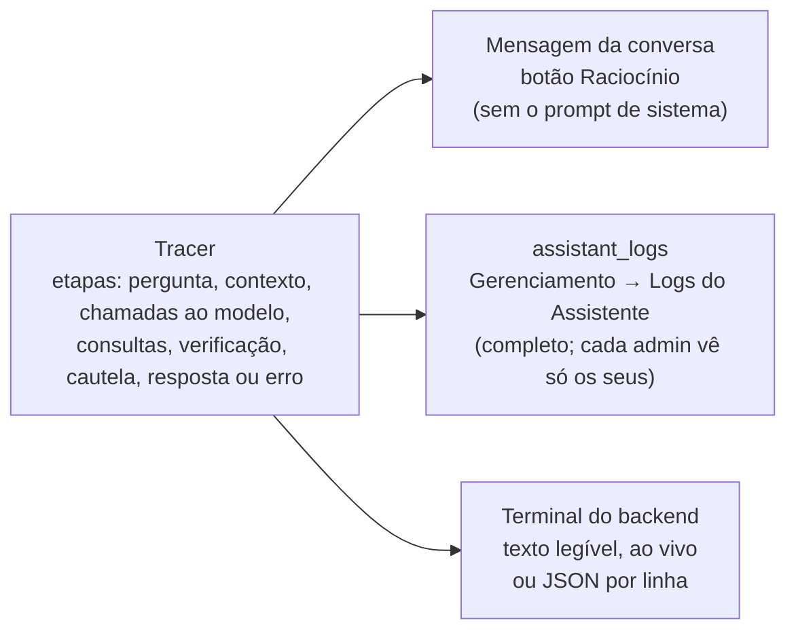

| Destino | Quem vê | Conteúdo | Retenção |
|---|---|---|---|
| Botão **Raciocínio** | O próprio usuário | Tudo, exceto o prompt de sistema | Com a conversa (7 dias) |
| **Logs do Assistente** | Só o administrador dono dos registros | Tudo, inclusive falhas e testes de conexão | `ASSISTANT_LOG_DAYS` (30) |
| **Terminal** | Quem opera o servidor | `summary` sem conteúdo do usuário, `full` tudo, `off` nada | A dos logs do Docker |

Exemplo do terminal (`docker compose logs -f backend`):

```text
═══ ASSISTENTE · pergunta · rastreio c727873b91cb ═══════════════════════════
13:13:14 [c727873b91cb +4 ms] 1. Pergunta recebida
      modelo: groq · openai/gpt-oss-120b (padrão do servidor)
13:13:14 [c727873b91cb +22 ms] … aguardando o modelo openai/gpt-oss-120b (rodada 1, 2 mensagens, 3.201 caracteres)
13:13:15 [c727873b91cb +523 ms] 3. Chamada ao modelo #1 · 501 ms
      decisão: pediu 1 consulta → get_current_snapshot(sem argumentos)
13:13:15 [c727873b91cb +965 ms] 4. Consulta: Situação atual (cards do dashboard) · 442 ms · ✓ ok
13:13:15 [c727873b91cb +1,5 s] 6. Verificação de valores
      ✓ R$ 39.699,22
═══ ✓ CONCLUÍDA em 1,5 s · 2 chamadas ao modelo · 1 consulta · 3.190 + 169 tokens ═══
```

---

## 14. Segurança em camadas

| Camada | Proteção |
|---|---|
| Rede | Compose publica as portas só em `127.0.0.1`; a API envia `X-Content-Type-Options`, `X-Frame-Options` e `Referrer-Policy` |
| Entrada | Pydantic valida tipos e tamanhos (iguais às colunas); foto só como URL `http(s)` |
| Autenticação | Argon2id, limite de tentativas de login, tempo igual para e-mail inexistente, JWT curto, refresh rotativo |
| Autorização | Sessão em toda rota (exceto login/refresh); filtro por dono em toda consulta; ADMIN para gerenciamento |
| Segredos | `JWT_SECRET` obrigatório e não público; chaves de API dos usuários cifradas (Fernet) e nunca devolvidas |
| Assistente | Somente leitura, isolamento no código, SSRF bloqueado, logs completos visíveis só ao próprio administrador |
| Dados pessoais e o LLM | Minimização do que é enviado e mascaramento de CPF, CNPJ, cartão, e-mail, telefone e chave Pix antes de qualquer envio ao provedor; Ollama como opção 100% local |
| Dependências | Versões fixadas, `npm ci`, auditoria com `pip-audit` e `npm audit` |

O histórico das revisões de segurança, com cada problema encontrado e a correção, está
em [`decisions.md`](decisions.md#revisão-de-segurança-fase-8-preparação-para-o-portfólio).
